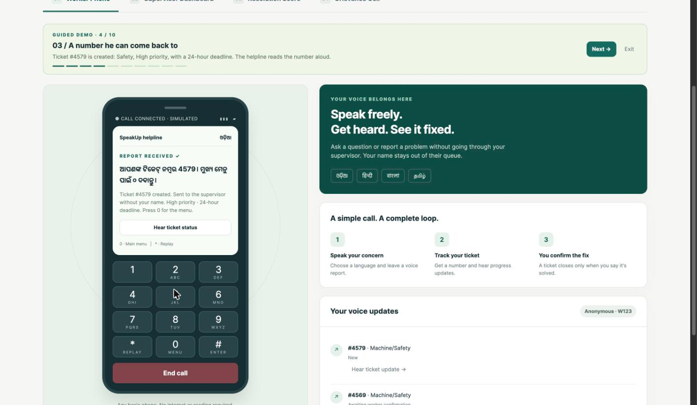
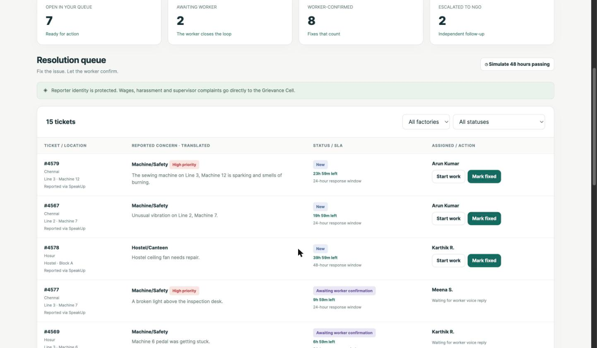
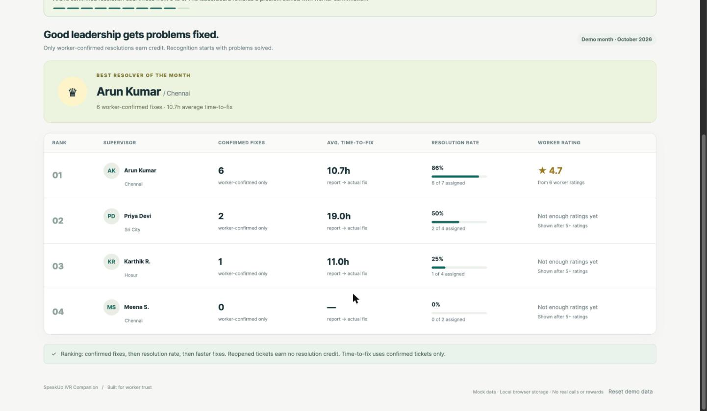
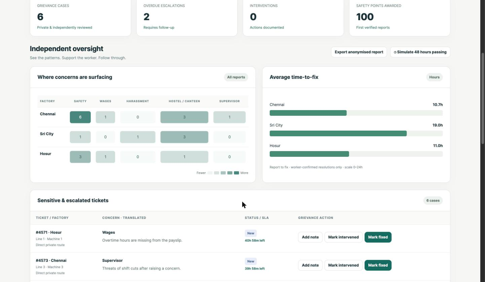
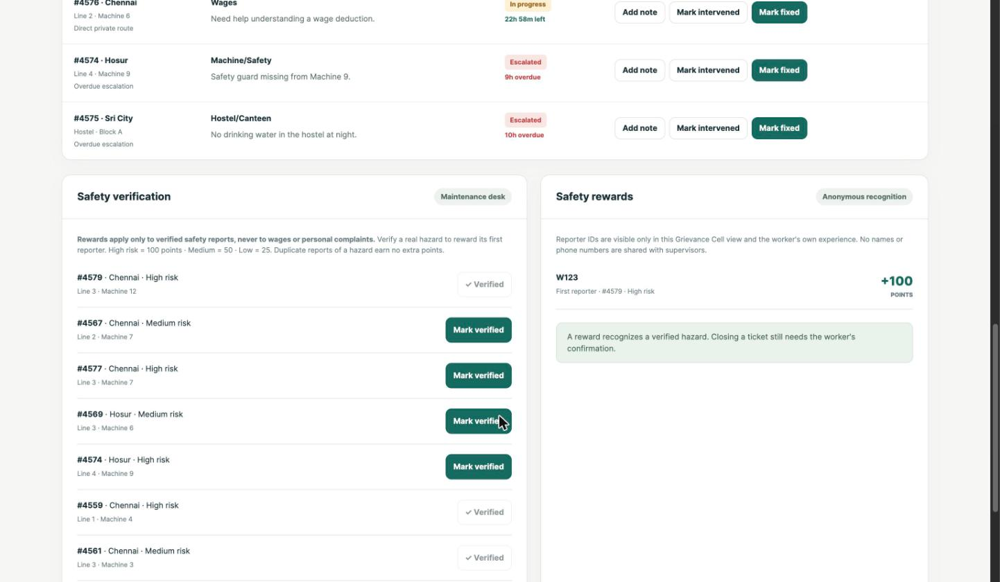

# SpeakUp: IVR Companion for Migrant Factory Workers

**Every worker's voice, tracked to the fix.**

SpeakUp is a prototype toll-free voice helpline that lets migrant factory workers in India report problems in their own language from any basic phone, track every complaint with a ticket number, and confirm when it is actually fixed.

Built in two hours at the **TCS iON AI Hackathon** (Amity University Online, 30 October 2026), under the *Inclusive Workforce* theme and the *Factory Worker's AI Companion* challenge.

**Live demo:** https://dhruva-neelakantapuram.github.io/speakup-ivr-companion/ (click **Demo: Ramesh's story** for a guided walkthrough)



## The problem

Industrial areas in Tamil Nadu and Andhra Pradesh employ many migrant workers from states like Odisha, Bihar, Jharkhand and Assam. Many cannot read English or the local language and are not comfortable with apps or forms. Safety rules, shift changes and pay slips are hard to understand, and complaints about faulty machines or short wages often go unreported out of fear, or disappear without any update.

## Root cause

A 5 Whys analysis pointed to incentives: managers are judged on how few complaints are visible, so problems get hidden rather than fixed, and workers are left without a safe, trackable way to raise them.

## How SpeakUp works

- **Call from any phone:** choose Odia, Hindi, Bengali or Tamil. No reading, typing or smartphone needed.
- **Speak the complaint:** speech-to-text and translation turn it into a categorised ticket with a number the worker can come back to.
- **Factory fixes first:** routine issues go to the supervisor with a deadline (24 hours for safety, 48 hours for others). Overdue tickets escalate automatically.
- **Sensitive issues bypass the supervisor:** wages, harassment and supervisor complaints go straight to a neutral grievance cell (NGO or legal aid).
- **The worker closes the loop:** a ticket is resolved only when the worker presses 1 to confirm the fix.
- **Identity protected:** supervisors never see the reporter's name or phone number.

## What makes it different

- **Supervisor Resolution Score:** supervisors are ranked on worker-confirmed fixes, resolution rate and time-to-fix, not on how few complaints they receive. Worker ratings are anonymous and shown only as an average after five or more ratings.
- **Safety Report Rewards:** the first worker to report a verified hazard, such as a sparking machine, earns reward points under an anonymous ID. Rewards apply only to safety reports, never to personal complaints like wages.

> We don't count complaints against supervisors. We count fixes for them.

## Demo story

Ramesh, an Odia-speaking machine operator from Odisha, calls the helpline and reports a sewing machine that is sparking on Line 3. He gets ticket #4579. The supervisor sees the complaint without his name and has the machine fixed. Ramesh presses 1 to confirm, the supervisor's score goes up, and his anonymous ID earns safety reward points.

## Screenshots

**Supervisor queue:** ticket #4579 with no worker name, and a deadline on every ticket.



**Supervisor Resolution Score:** only worker-confirmed fixes count.



**Grievance cell:** where complaints are surfacing, and the average time-to-fix per factory.



**Safety rewards:** the first verified reporter, anonymous ID W123, earns points.



## What's in this repo

| Folder | What it is |
|---|---|
| `docs/` | Single-file HTML prototype (the live demo) and screenshots. Open `docs/index.html` in any browser. |
| `ai-studio-version/` | React + TypeScript + Vite version built with Google AI Studio, including tests for the routing, scoring and reward rules (`src/utils/ivrRules.test.ts`). |

### Run the AI Studio version locally

```bash
cd ai-studio-version
npm install
npm run dev
```

See `.env.example` for the optional environment variables.

## Status

Hackathon prototype. All names and data are mock data, and calls, speech-to-text, translation and rewards are simulated.

## Built by

Dhruva Neelakantapuram, BCA student at Amity University Online. Built with AI-assisted tools (Google AI Studio and OpenAI Codex).

[LinkedIn](https://www.linkedin.com/in/n-dhruva-403b61236/) · [GitHub](https://github.com/Dhruva-Neelakantapuram)
